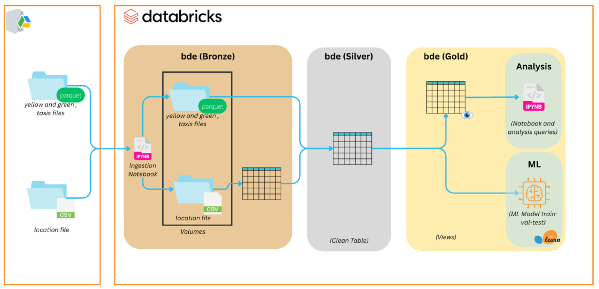
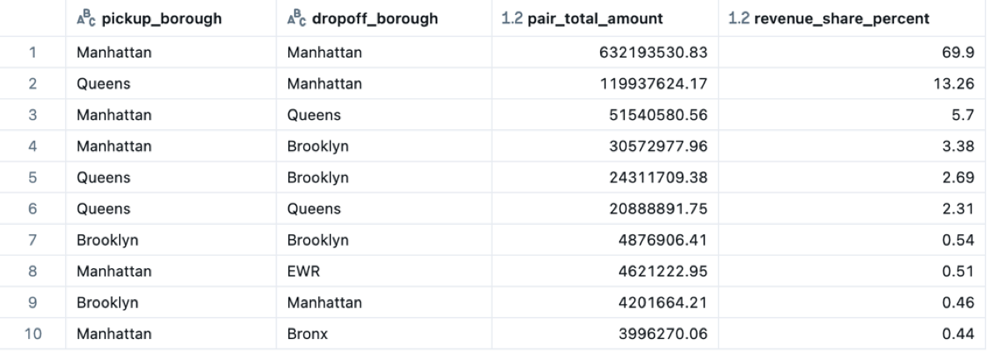
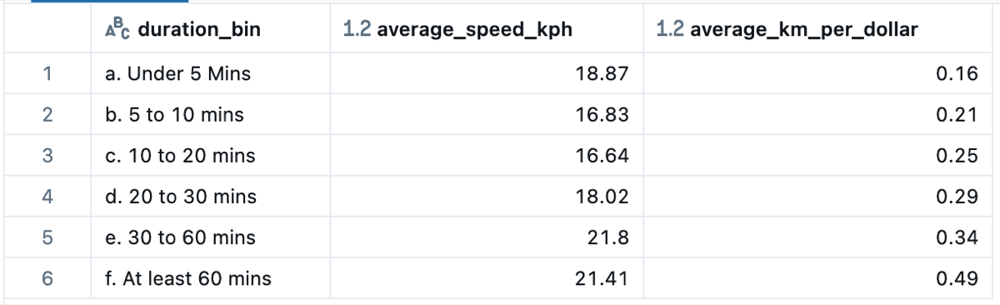
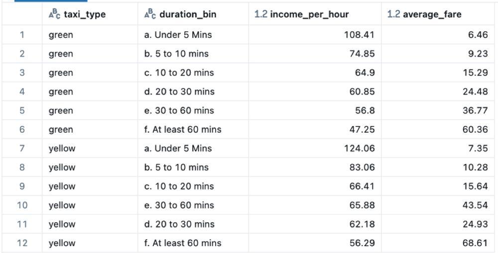
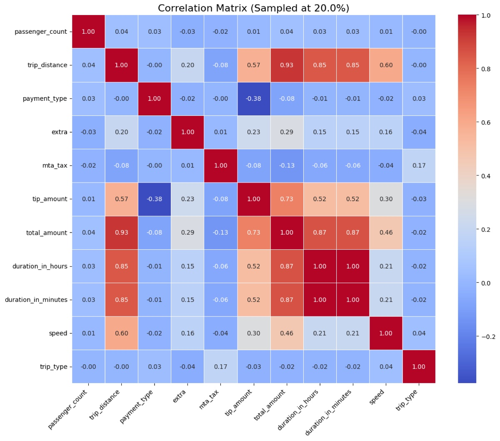
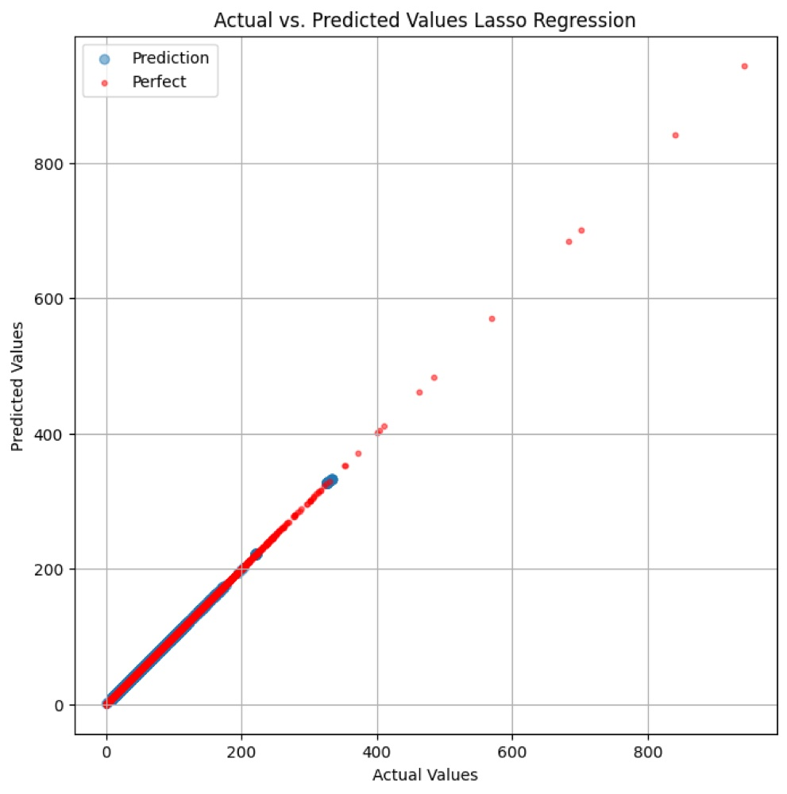
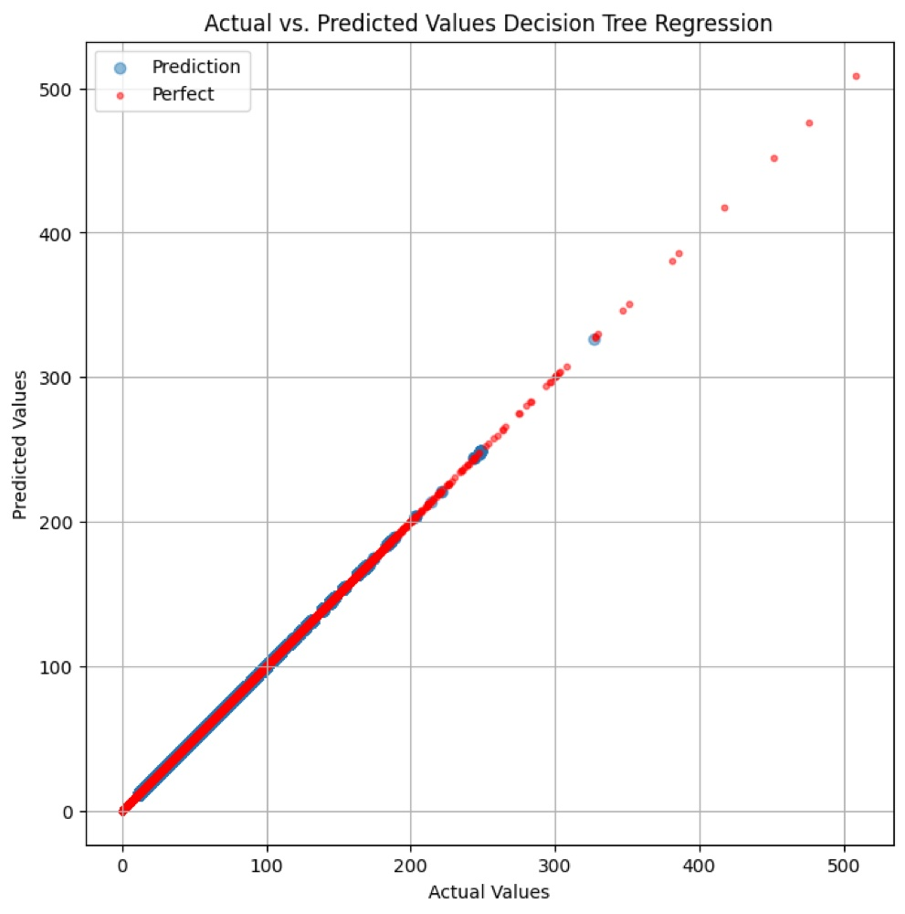

# NYC Taxi Trips: Lakehouse Pipeline and Fare Prediction on Databricks

Almost a billion taxi trips from the New York City Taxi & Limousine Commission (TLC), ingested into **Databricks**, cleaned with **PySpark** into a single trustworthy Delta table, exposed as **Spark SQL views** that answer business questions, and used to train a model that predicts the total fare of a trip.

## The data

Trip-level records published by the [TLC](https://www.nyc.gov/site/tlc/about/tlc-trip-record-data.page) as Parquet, plus the taxi-zone lookup CSV.

| Source | File | Size | Records |
|---|---|---|---|
| Yellow taxis | `yellow_taxi.parquet` | 11.78 GB | 907,982,776 |
| Green taxis | `green_taxi.parquet` | 1.26 GB | 83,484,688 |
| Zone lookup | `taxi_zone_lookup.csv` | 12 KB | 265 zones |

The raw data is messy: trip distances from -20,329 to 360,068 miles, a minimum fare of -$133 million, passenger counts of 48 and 208, and surcharge columns that are mostly null.

## Pipeline

| Layer | Notebook | What happens |
|---|---|---|
| **Bronze** | [`00_ingest_to_volumes`](notebooks/00_ingest_to_volumes.ipynb), [`01_eda`](notebooks/01_eda.ipynb) | Files land in Unity Catalog volumes under `workspace.bde.assignment2/{green,yellow,location}`. The EDA notebook profiles schema, nulls and distributions. |
| **Silver** | [`02_data_cleansing`](notebooks/02_data_cleansing.ipynb) | Both taxi datasets are filtered, unified and enriched with borough and zone names, then saved as one Delta table. |
| **Gold** | [`03_gold_views`](notebooks/03_gold_views.ipynb) | Pre-aggregated Spark SQL views for each business question. |
| **ML** | [`04_ml_modelling`](notebooks/04_ml_modelling.ipynb) | Feature selection, a baseline, Lasso and Decision Tree regressors, time-based evaluation. |

### Cleaning rules (Silver)

| Rule | Action |
|---|---|
| Chronology | Drop trips whose drop-off is before pick-up |
| Realistic dates | Drop pick-up or drop-off years after 2024 |
| Speed | Compute duration and speed; keep speed > 0 and under the limit (25 mph yellow, 30 mph green) |
| Duration and distance | Keep 1 min to 3 h and 0.1 to 40 miles |
| High-null columns | Drop `ehail_fee`, `airport_fee`, `congestion_surcharge` |
| Uninformative columns | Drop `improvement_surcharge` (90% null or a constant 0.3) |
| Core fields | Drop zero-passenger trips and remaining nulls; impute `trip_type` and `store_and_fwd_flag` with the mode |
| Unification | Rename datetime columns, add `taxi_type`, union, join zones for pick-up and drop-off |
| Final filters | Remove unknown boroughs, negative amounts and more than 6 passengers |

## What the data says (Gold views)

| Question | View | Finding |
|---|---|---|
| Trips per month | `trips_per_month` | 2.5M to 3.2M trips a month through 2024 |
| Busiest weekday | `top_weekdays` | Thursday most often, then Tuesday and Saturday |
| Busiest hour | `top_hours` | 6 pm, consistently |
| Revenue share of top 10 borough pairs, 2024 | `top_pickup_dropoff_pairs_revenue_2024` | Manhattan to Manhattan takes 69.9%, Queens to Manhattan 13.3% |
| Trips with a tip | `percentage_of_trips_with_tips` | 63.07% |
| Tips of at least $15 | `percentage_of_trips_with_at_least_15` | 0.48% of tipped trips |

### Which trips should a driver target?

Trips are binned by duration and compared on speed, distance per dollar and income per hour.

Short trips win by a wide margin. Under-5-minute fares earn **$124 per hour for yellow** and **$108 per hour for green** taxis, and hourly income falls with every longer bin, down to $56 and $47 for trips over an hour. Yellow taxis out-earn green taxis in every bin.

## Predicting the total fare

Data from 2024 was split by time: train January to July, validate August to September, test from October. A 30% sample was used for compute reasons. A correlation matrix and Welch's ANOVA guided feature selection; `duration_in_hours`, `duration_in_minutes` and `speed` were dropped as redundant with distance and with each other.

| Model | Hyperparameters | Train RMSE | Validation RMSE | Gap |
|---|---|---|---|---|
| Baseline (historical average per route, time and taxi type) | – | 22.86 | 30.53 | 7.67 |
| Lasso | alpha = 0.1 | 4.54 | 5.11 | 0.57 |
| Lasso | alpha = 0.25 | 4.56 | 5.15 | 0.58 |
| Lasso | alpha = 0.5 | 4.66 | 5.25 | 0.60 |
| Decision Tree | depth 25, min leaf 8 | 2.92 | 3.66 | 0.74 |
| Decision Tree | depth 15, min leaf 4 | 3.11 | 3.76 | 0.65 |
| **Decision Tree** | **depth 8, min leaf 4** | **3.72** | **4.20** | **0.48** |

The depth-8 Decision Tree was selected: not the lowest validation error, but the smallest train-validation gap and therefore the least risk of overfitting. Retrained on train plus validation, it reached **RMSE 4.26 on the held-out test set**, against 30.5 for the baseline.

  
  

## Recommendations

- **Volume over duration.** Drivers earn more per hour chaining short fares than taking long trips.
- **Strengthen the Queens to Manhattan corridor.** The second most profitable route, with 13% of top-pair revenue, deserves higher driver availability in Queens at peak times.
- **Staff the 6 pm peak.** Dynamic incentives could match supply to the consistent evening surge.
- **Retrain on more data.** The model is production-ready on a representative 30% sample; a 50% to 100% sample would improve it further.

## Running it

Import the notebooks into a Databricks workspace with Unity Catalog, create the `workspace.bde` schema, install `requirements.txt` on the cluster and run the notebooks in order. Notebook 00 downloads the source files into volumes; 02 writes the Silver Delta table that 03 and 04 read.

## Report

The full write-up with data dictionaries and result tables is in [`report/nyc_taxi_pipeline_report.pdf`](report/nyc_taxi_pipeline_report.pdf).

## Stack

Databricks · Unity Catalog · Delta Lake · PySpark · Spark SQL · scikit-learn · Altair · pingouin
